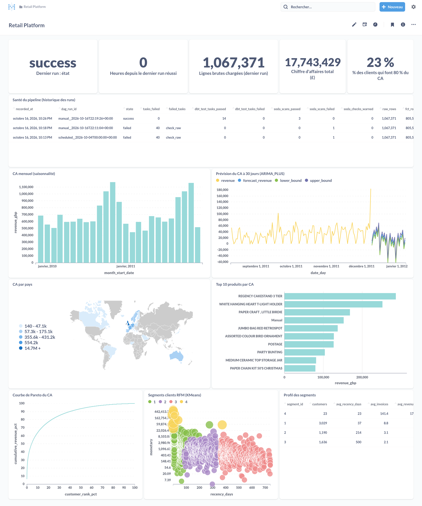
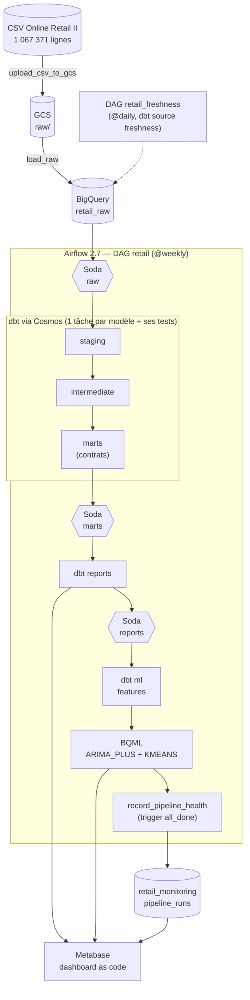

# Retail GCP Pipeline

Plateforme de données batch sur GCP : un million de lignes de ventes e-commerce
chargées chaque semaine dans BigQuery, transformées par dbt en 5 couches
testées, contrôlées par Soda à chaque étape, enrichies par deux modèles BQML et
exposées dans un dashboard Metabase versionné en code. Chaque run écrit son
propre bilan de santé.



## Ce que le pipeline produit

Chiffres du dernier run de production (`manual__2026-10-17T00:06:19`), relus
dans BigQuery. Chacun renvoie au code qui le calcule.

| Résultat | Valeur | Produit par |
|---|---|---|
| Lignes brutes chargées | 1 067 371 (2009-12-01 → 2011-12-09) | `load_raw`, [`dags/online_retail.py`](dags/online_retail.py) |
| Lignes de vente dans la table de faits | 802 651 (36 594 factures, 5 852 clients) | [`fct_invoice_lines`](include/dbt/models/marts/fct_invoice_lines.sql) |
| Chiffre d'affaires marchandises | 17 434 465 £ | [`rpt_monthly_revenue`](include/dbt/models/reports/rpt_monthly_revenue.sql) |
| Part des clients qui font 80 % du CA | 23,1 % | [`rpt_customer_revenue_concentration`](include/dbt/models/reports/rpt_customer_revenue_concentration.sql) |
| Prévision du CA journalier | 30 jours, intervalle à 80 % (BQML `ARIMA_PLUS`) | `train_revenue_forecast`, `forecast_revenue` |
| Segmentation RFM | 4 segments (BQML `KMEANS`) | `train_customer_segments`, `score_customer_segments` |
| Bilan du run | 48 tâches OK, 16 tâches de tests dbt, 3 scans Soda, 0 alerte | [`pipeline_health.py`](include/monitoring/pipeline_health.py) |

Le périmètre « ventes » est volontairement restreint : lignes à quantité et prix
positifs, client identifié, code article qui est un produit (frais de port,
ajustements manuels, frais bancaires, bons cadeaux… sont listés dans
[un seed revu](include/dbt/seeds/non_merchandise_stock_codes.csv)). Ce
périmètre est défini à un seul endroit :
[`int_invoice_lines__customer_sales`](include/dbt/models/intermediate/int_invoice_lines__customer_sales.sql).

## Architecture



| Couche | Dataset BigQuery | Matérialisation | Rôle |
|---|---|---|---|
| raw | `retail_raw` | table (schéma explicite, `max_bad_records=0`) | copie fidèle du CSV |
| staging | `retail_staging` | vue | typage, renommage, drapeaux ; aucune ligne filtrée |
| intermediate | `retail_intermediate` | vue | périmètre des ventes, clé produit |
| marts | `retail_marts` | table, **contrat imposé** | `fct_invoice_lines`, `dim_customers`, `dim_products`, `dim_dates` |
| reports | `retail_reports` | table, contrat imposé | CA par pays, mois, produit ; courbe de Pareto |
| ml | `retail_ml` | table | séries et features pour BQML, sorties des modèles |
| monitoring | `retail_monitoring` | table | une ligne par run du DAG |

## Démarrage rapide

Prérequis : Docker, Python 3.12, `gcloud`, un projet GCP avec facturation.

```bash
# 0. Une fois : ressources GCP (bucket, compte de service à moindre privilège, clé)
PROJECT_ID=mon-projet BILLING_ACCOUNT=XXXXXX-XXXXXX-XXXXXX ./scripts/setup_gcp.sh
cp .env.example .env   # puis remplir GCP_PROJECT_ID, GCS_BUCKET, mot de passe admin, clé Fernet (make fernet-key)
```

```bash
make setup dataset   # venv + outils + hooks git + dbt deps, puis CSV complet téléchargé depuis l'UCI
make up              # Airflow (http://localhost:8088) + Metabase (http://localhost:3002)
make run             # déclenche le DAG retail
```

Metabase : créer le compte admin et la connexion BigQuery « Retail BQ » au
premier lancement (étape manuelle), renseigner `MB_ADMIN_*` dans `.env`, puis
`make metabase` crée la collection, les 13 questions et le dashboard.

Autres cibles : `make help`. `make test` lance tout ce que la CI lance.

## Qualité et tests

| Niveau | Quoi | Où |
|---|---|---|
| Lint | ruff, sqlfluff (templater dbt), yaml, détection de clés privées | [`.pre-commit-config.yaml`](.pre-commit-config.yaml), hook git + CI |
| dbt | 53 tests génériques ; 3 tests singuliers (réconciliation des rapports avec la table de faits, courbe de Pareto, série journalière sans trou) ; 2 tests unitaires ; contrats sur marts et reports | [`include/dbt/`](include/dbt) |
| Soda | volume vs dernier run réussi, part de clients manquants, part d'annulations, part fct/raw, mois manquants, concentration du CA ; seuils warn/fail tirés des valeurs mesurées | [`include/soda/checks/`](include/soda/checks) |
| Fraîcheur | `dbt source freshness` quotidien sur les métadonnées de la table brute (warn 8 j, error 15 j) | [`dags/retail_freshness.py`](dags/retail_freshness.py) |
| Python | 17 tests pytest : intégrité du DAG dans l'image Airflow, logique de santé et d'alerte | [`tests/`](tests) |

### CI (GitHub Actions)

À chaque PR, [trois jobs](.github/workflows/ci.yml) :

1. **Contrôles statiques**, sans identifiants : pre-commit, `dbt parse`.
2. **Intégrité du DAG** : construction de l'image Airflow, pytest dedans.
3. **Slim CI dbt sur BigQuery** : authentification sans clé (Workload Identity
   Federation), `dbt build --select state:modified+ --defer` contre le manifest
   de production publié par le dernier push sur `master`, dans des datasets
   `retail_ci_pr<N>_*` supprimés en fin de job.

## Décisions

Chaque choix discutable est tracé dans un ADR :

- [ADR 001](docs/adr/001-dbt-layering-and-contracts.md) — couches dbt et contrats sur les tables exposées
- [ADR 002](docs/adr/002-keyless-slim-ci.md) — CI sans clé (WIF) et slim CI avec `--defer`
- [ADR 003](docs/adr/003-dbt-tests-vs-soda-thresholds.md) — tests dbt pour les invariants, Soda pour les seuils statistiques
- [ADR 004](docs/adr/004-pipeline-health-in-bigquery.md) — santé du pipeline dans une table BigQuery

Portabilité : [étude Snowflake vs BigQuery](docs/snowflake_vs_bigquery.md)
(inventaire fichier par fichier, plan de portage). Les modèles utilisent déjà
les macros cross-database de dbt (`dbt.type_*`, `dbt.dateadd`, `dbt.datediff`,
`dbt_utils.date_spine`) ; la cible Snowflake n'est pas encore implémentée.

## Limites connues

- **Jeu de données statique** : le CSV ne change pas ; le DAG le recharge en
  entier (`WRITE_TRUNCATE`) chaque semaine. Pas de modèle incrémental : à
  un million de lignes, le rechargement complet est plus simple que la logique
  de merge.
- **Exécution locale** : Airflow tourne en docker compose avec un
  LocalExecutor. Rien n'est déployé sur Composer ou Kubernetes.
- **Bilan de santé** : `raw_rows` et `fct_rows` sont lus dans les métadonnées
  des tables en fin de run. Après un échec précoce, ils montrent les volumes
  du run précédent.
- **Prévision** : la série journalière est complétée par des zéros les jours
  sans vente, donc la borne basse de l'intervalle ARIMA passe sous zéro. Les
  numéros de segments KMeans changent à chaque réentraînement.
- **Metabase** : la connexion BigQuery et le compte admin se créent à la main ;
  le dashboard n'est pas vérifié en CI (il est déclaré comme
  [exposure dbt](include/dbt/models/reports/_exposures.yml)). Metabase plafonne
  les résultats à 2 000 lignes : la courbe de Pareto est agrégée par tranche de
  0,1 % de clients, le nuage des segments est un échantillon déterministe d'un
  client sur trois.
- **Alerte** : en cas d'échec, un log JSON structuré est toujours écrit ;
  l'envoi Slack n'a lieu que si `SLACK_WEBHOOK_URL` est défini.

## Origine et contributions personnelles

Le projet est parti d'un tutoriel public Airflow / Astronomer (dataset Online
Retail, Soda dans un `external_python`, dbt via Cosmos, rapports Metabase).
Ce qui a été ajouté ou refait ensuite :

- migration d'Astro CLI vers Apache Airflow vanilla en docker compose ;
- étage ML BQML : prévision `ARIMA_PLUS` et segmentation RFM `KMEANS` ;
- reconstruction du CSV complet depuis la source UCI (l'ancien fichier était
  tronqué à 1 048 575 lignes et contenait 17 752 lignes corrompues) et
  réparation du seed des pays ;
- refonte dbt en staging / intermediate / marts / reports / ml, contrats,
  tests unitaires et singuliers, cibles dev / ci / prod, exclusion des codes
  non-produits ;
- CI : slim CI sur BigQuery sans clé, tests du DAG dans l'image ;
- observabilité : table de santé par run, fraîcheur de la source, alerte
  d'échec, seuils Soda justifiés ;
- sécurité : secrets hors du code, compte de service à moindre privilège ;
- dashboard Metabase provisionné en code ;
- outillage : Makefile, pre-commit, sqlfluff.

## Stack

Airflow 2.7.3 · astronomer-cosmos 1.11 · dbt-core 1.11 + dbt-bigquery ·
Soda Core 3.0 · BigQuery + BQML · Cloud Storage · Metabase 0.46 ·
GitHub Actions · Docker Compose.

Données : [Online Retail II](https://archive.ics.uci.edu/dataset/502/online+retail+ii),
UCI Machine Learning Repository (CC BY 4.0).
