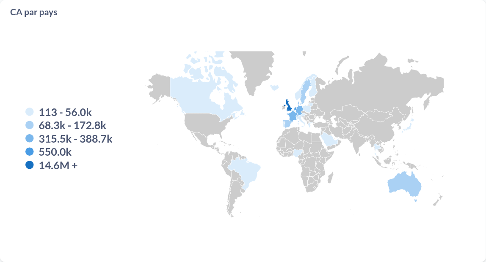
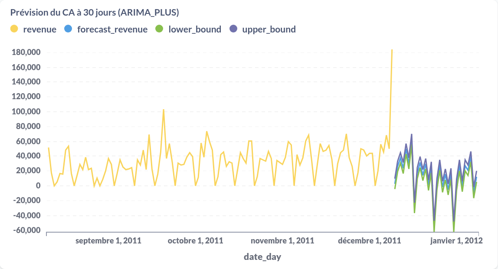
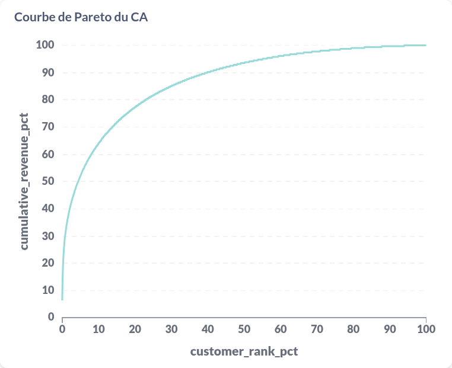
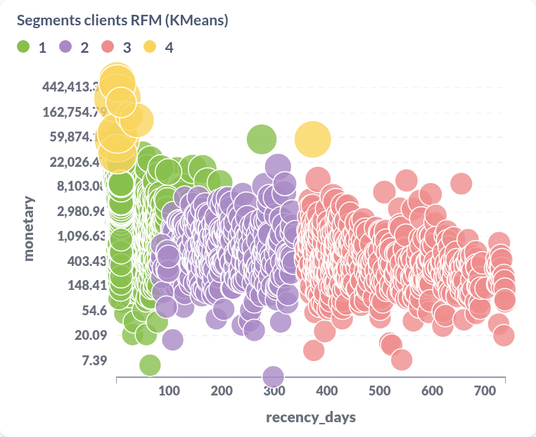
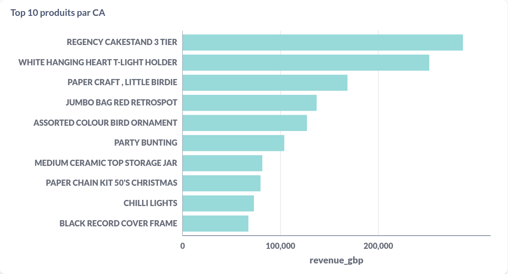
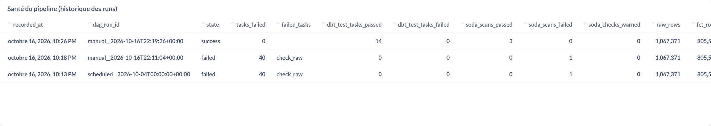
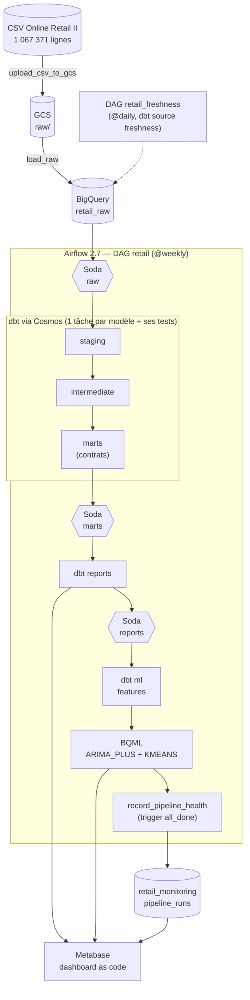
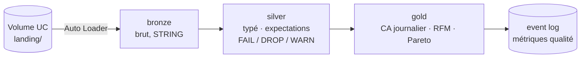

<div align="center">

# Retail Data Platform

**Un million de lignes de ventes e-commerce, du CSV brut au dashboard et aux modèles ML,
sur deux plateformes : BigQuery et Databricks.**

[](https://github.com/AmidNova/retail-gcp-pipeline/actions/workflows/ci.yml)


[Résultats](#-résultats) ·
[Architecture](#-architecture) ·
[Démarrage](#-démarrage-rapide) ·
[Qualité](#-qualité-et-tests) ·
[Databricks](#-port-databricks) ·
[Décisions](#-décisions) ·
[Limites](#️-limites-connues)


</div>

## En bref

- **Pipeline batch hebdomadaire sur GCP** : Airflow charge le CSV dans
  BigQuery. dbt le transforme en 5 couches testées, avec des contrats sur les
  tables exposées. Soda contrôle chaque frontière, deux modèles BQML prévoient
  et segmentent, et un dashboard Metabase est provisionné en code.
- **Même logique portée sur Databricks** : un pipeline Lakeflow en médaillon,
  avec ingestion incrémentale par Auto Loader et règles qualité en
  expectations, déployé en bundle. Les chiffres sont **identiques à la ligne
  près** à ceux de BigQuery.
- **Tout est vérifiable** : chaque run écrit son propre bilan de santé. Chaque
  PR passe 4 jobs de CI, dont un slim CI dbt sur BigQuery sans clé. Chaque
  choix discutable a son ADR.

## 📊 Résultats

Derniers runs de production, relus dans BigQuery et dans Databricks :

| Résultat | BigQuery | Databricks | Produit par |
|---|---:|---:|---|
| Lignes brutes chargées (2009-12-01 → 2011-12-09) | 1 067 371 | 1 067 371 | [`dags/online_retail.py`](dags/online_retail.py) · [`01_bronze.sql`](databricks/pipeline/01_bronze.sql) |
| Lignes de vente (périmètre marchandises) | 802 651 | 802 651 | [`fct_invoice_lines`](include/dbt/models/marts/fct_invoice_lines.sql) · [`02_silver.sql`](databricks/pipeline/02_silver.sql) |
| Factures · clients | 36 594 · 5 852 | 36 594 · 5 852 | |
| Chiffre d'affaires marchandises | 17 434 465 £ | 17 434 465 £ | [`rpt_monthly_revenue`](include/dbt/models/reports/rpt_monthly_revenue.sql) |
| Part des clients qui font 80 % du CA | 23,1 % | 23,1 % | [`rpt_customer_revenue_concentration`](include/dbt/models/reports/rpt_customer_revenue_concentration.sql) · [`03_gold.sql`](databricks/pipeline/03_gold.sql) |
| Prévision du CA journalier | 30 j, IC 80 % (`ARIMA_PLUS`) | — | `train_revenue_forecast`, `forecast_revenue` |
| Segmentation RFM | 4 segments (`KMEANS`) | features prêtes (`gold.customer_rfm`) | `train_customer_segments` |
| Bilan du run | 48 tâches OK, 0 alerte | `TERMINATED SUCCESS`, 0 `FAIL UPDATE` | [`pipeline_health.py`](include/monitoring/pipeline_health.py) · event log |

Le périmètre « ventes » est défini à un seul endroit par plateforme :
quantité et prix positifs, client identifié, code article qui est un produit.
Les frais de port, ajustements manuels et bons cadeaux sont listés dans
[un seed revu](include/dbt/seeds/non_merchandise_stock_codes.csv).

<details>
<summary>Plus de captures du dashboard</summary>

| | |
|---|---|
|  |  |
|  |  |
|  |  |

</details>

## 🏗 Architecture

### GCP — plateforme de production



| Couche | Dataset BigQuery | Matérialisation | Rôle |
|---|---|---|---|
| raw | `retail_raw` | table (schéma explicite, `max_bad_records=0`) | copie fidèle du CSV |
| staging | `retail_staging` | vue | typage, renommage, drapeaux ; aucune ligne filtrée |
| intermediate | `retail_intermediate` | vue | périmètre des ventes, clé produit |
| marts | `retail_marts` | table, **contrat imposé** | `fct_invoice_lines`, `dim_customers`, `dim_products`, `dim_dates` |
| reports | `retail_reports` | table, contrat imposé | CA par pays, mois, produit ; courbe de Pareto |
| ml | `retail_ml` | table | séries et features pour BQML, sorties des modèles |
| monitoring | `retail_monitoring` | table | une ligne par run du DAG |

### Databricks — port Lakeflow



Détails, choix et comparaison : [**docs/databricks.md**](docs/databricks.md).

## 🚀 Démarrage rapide

### GCP

Prérequis : Docker, Python 3.12, `gcloud`, un projet GCP avec facturation.

```bash
# Une fois : bucket, compte de service à moindre privilège, clé
PROJECT_ID=mon-projet BILLING_ACCOUNT=XXXXXX-XXXXXX-XXXXXX ./scripts/setup_gcp.sh
cp .env.example .env   # GCP_PROJECT_ID, GCS_BUCKET, mot de passe admin, clé Fernet (make fernet-key)

make setup dataset     # venv, outils, hooks git, dbt deps, puis CSV complet depuis l'UCI
make up                # Airflow http://localhost:8088 · Metabase http://localhost:3002
make run               # déclenche le DAG retail
make metabase          # collection, 13 questions et dashboard (après création manuelle de l'admin)
```

### Databricks

Prérequis : [CLI Databricks](https://docs.databricks.com/dev-tools/cli/install.html), un workspace (Free Edition suffit), Spark local pour le smoke test.

```bash
databricks auth login --host https://<workspace>.cloud.databricks.com

make databricks-smoke    # SQL du pipeline sur Spark local, CSV complet
make databricks-setup    # catalog, schémas, volume, upload des CSV
make databricks-deploy   # bundle validate + deploy
make databricks-run      # lance le job retail_weekly et attend la fin
```

Puis [`databricks/validation/validation.sql`](databricks/validation/validation.sql) dans l'éditeur SQL.

`make help` liste toutes les cibles. `make test` lance ce que la CI lance côté GCP.

## ✅ Qualité et tests

| Niveau | Quoi | Où |
|---|---|---|
| Lint | ruff, sqlfluff (templater dbt), yaml, détection de clés privées | [`.pre-commit-config.yaml`](.pre-commit-config.yaml), hook git + CI |
| dbt | 53 tests génériques, 3 tests singuliers (réconciliation rapports ↔ faits, Pareto, série sans trou), 2 tests unitaires, contrats sur marts et reports | [`include/dbt/`](include/dbt) |
| Soda | Volume vs dernier run réussi, part de clients manquants, d'annulations, fct/raw, mois manquants, concentration du CA. Seuils warn/fail tirés des valeurs mesurées | [`include/soda/checks/`](include/soda/checks) |
| Fraîcheur | `dbt source freshness` quotidien (warn 8 j, error 15 j) | [`dags/retail_freshness.py`](dags/retail_freshness.py) |
| Python | 17 tests pytest : intégrité du DAG dans l'image Airflow, logique de santé et d'alerte | [`tests/`](tests) |
| Databricks | Expectations Lakeflow (FAIL / DROP / WARN). Smoke test sur Spark local : volumes attendus et contrôles d'intégrité. Validation post-run via l'event log | [`databricks/`](databricks) |

### CI — 4 jobs à chaque PR

| Job | Ce qu'il garantit |
|---|---|
| **Contrôles statiques** | pre-commit + `dbt parse`, sans aucun identifiant |
| **Intégrité du DAG** | image Airflow construite, pytest exécuté dedans |
| **Slim CI dbt sur BigQuery** | authentification **sans clé** (Workload Identity Federation). `dbt build --select state:modified+ --defer` contre le manifest de prod, dans des datasets `retail_ci_pr<N>_*` supprimés en fin de job |
| **SQL Databricks** | le pipeline Lakeflow sur un fixture de 10 lignes (une par règle) : volumes attendus pour chaque table, contrôles d'intégrité à 0 |

## 🧱 Port Databricks

Le cœur du pipeline (ingestion, nettoyage, périmètre des ventes, tables
d'analyse) réécrit en **Lakeflow Declarative Pipeline** sur Databricks Free
Edition, pour montrer que la logique tient sur un autre paradigme : lakehouse
Delta et Unity Catalog, au lieu d'un entrepôt SQL serverless.

| | GCP | Databricks |
|---|---|---|
| Ingestion | rechargement complet hebdomadaire | **incrémentale** (Auto Loader) |
| Qualité | tests dbt + seuils Soda | **expectations** : FAIL si illisible, DROP si hors périmètre, WARN pour mesurer |
| Lignes écartées | filtre `WHERE` | comptées **règle par règle** dans l'event log |
| Déploiement | docker compose + Airflow | **bundle** (`databricks.yml`) + job |
| Résultat | 802 651 lignes · 17 434 465 £ | **identique** |

→ Le quoi, le comment et le pourquoi : [**docs/databricks.md**](docs/databricks.md)

## 🧭 Décisions

| | Décision |
|---|---|
| [ADR 001](docs/adr/001-dbt-layering-and-contracts.md) | Couches dbt et contrats sur les tables exposées |
| [ADR 002](docs/adr/002-keyless-slim-ci.md) | CI sans clé (WIF) et slim CI avec `--defer` |
| [ADR 003](docs/adr/003-dbt-tests-vs-soda-thresholds.md) | Tests dbt pour les invariants, Soda pour les seuils statistiques |
| [ADR 004](docs/adr/004-pipeline-health-in-bigquery.md) | Santé du pipeline dans une table BigQuery |
| [Port Databricks](docs/databricks.md) | Médaillon Lakeflow, choix FAIL / DROP / WARN, tests sans workspace |
| [Snowflake vs BigQuery](docs/snowflake_vs_bigquery.md) | Étude de portabilité, fichier par fichier (non implémentée) |

## 📁 Structure

```
.
├── dags/                     # DAG retail (@weekly) et retail_freshness (@daily)
├── include/
│   ├── dbt/                  # staging → intermediate → marts → reports → ml
│   ├── soda/                 # checks par frontière de couche
│   └── monitoring/           # bilan de santé de chaque run
├── databricks/
│   ├── databricks.yml        # bundle : pipeline + job
│   ├── pipeline/             # 01_bronze · 02_silver · 03_gold (Lakeflow SQL)
│   ├── validation/           # requêtes post-run avec valeurs attendues
│   └── tests/                # smoke test Spark local + fixtures CI
├── scripts/                  # setup GCP, WIF, Databricks, dataset, Metabase
├── docs/                     # ADR, port Databricks, étude Snowflake
├── tests/                    # pytest : DAG, monitoring
└── Makefile                  # point d'entrée unique (make help)
```

## ⚠️ Limites connues

- **Jeu de données statique** : le CSV ne change pas. Côté GCP, il est
  rechargé en entier chaque semaine (`WRITE_TRUNCATE`) : à un million de
  lignes, c'est plus simple qu'une logique de merge.
- **Exécution locale** : Airflow tourne en docker compose (LocalExecutor). Rien
  n'est déployé sur Composer ou Kubernetes.
- **Bilan de santé** : `raw_rows` et `fct_rows` sont lus en fin de run. Après
  un échec précoce, ils montrent les volumes du run précédent.
- **Prévision** : la série journalière est complétée par des zéros, donc la
  borne basse de l'intervalle ARIMA passe sous zéro. Les numéros de segments
  KMeans changent à chaque réentraînement.
- **Metabase** : la connexion BigQuery et l'admin se créent à la main. Les
  résultats sont plafonnés à 2 000 lignes, d'où un Pareto agrégé et un nuage
  échantillonné.
- **Alerte** : un log JSON structuré est toujours écrit. Slack ne reçoit
  l'alerte que si `SLACK_WEBHOOK_URL` est défini.
- **Databricks** : Free Edition, job en pause, pas de déploiement en CI (SQL
  testé sur Spark local seulement). Voir [les limites du port](docs/databricks.md#6-limites).

## 🌱 Origine et contributions personnelles

Parti d'un tutoriel public Airflow / Astronomer (dataset Online Retail, Soda,
dbt via Cosmos, Metabase). Ajouté ou refait ensuite :

- migration d'Astro CLI vers Apache Airflow vanilla en docker compose ;
- étage ML BQML : prévision `ARIMA_PLUS` et segmentation RFM `KMEANS` ;
- reconstruction du CSV complet depuis l'UCI (l'ancien était tronqué à
  1 048 575 lignes, avec 17 752 lignes corrompues) et réparation du seed pays ;
- refonte dbt en 5 couches, contrats, tests unitaires et singuliers, cibles
  dev / ci / prod, exclusion des codes non-produits ;
- CI : slim CI BigQuery sans clé, tests du DAG dans l'image, SQL Databricks ;
- observabilité : santé par run, fraîcheur, alerte d'échec, seuils Soda justifiés ;
- sécurité : secrets hors du code, compte de service à moindre privilège ;
- dashboard Metabase provisionné en code ;
- **port Databricks** : médaillon Lakeflow, bundle, setup scripté, smoke test ;
- outillage : Makefile, pre-commit, sqlfluff.

## 🛠 Stack

**Orchestration** Airflow 2.7.3 · astronomer-cosmos 1.11 ·
**Transformation** dbt-core 1.11 + dbt-bigquery · Lakeflow Declarative Pipelines ·
**Stockage** BigQuery · Cloud Storage · Delta Lake / Unity Catalog ·
**Qualité** Soda Core 3.0 · expectations Lakeflow ·
**ML** BQML · **BI** Metabase 0.46 ·
**Infra** Docker Compose · Databricks bundles · GitHub Actions (WIF)

Données : [Online Retail II](https://archive.ics.uci.edu/dataset/502/online+retail+ii),
UCI Machine Learning Repository (CC BY 4.0).
