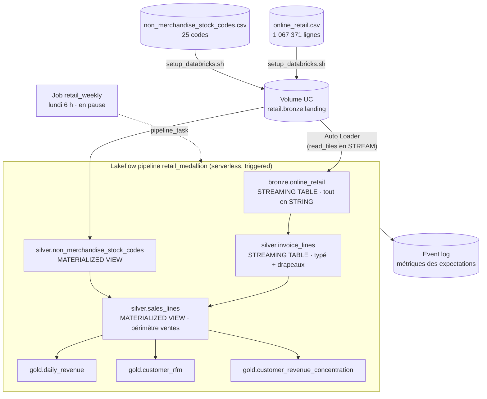

# Port Databricks — quoi, comment, pourquoi

> **Statut** : déployé et exécuté sur Databricks Free Edition le 2026-10-17.
> Les volumes et les montants sont **identiques à la ligne près** à ceux du
> pipeline BigQuery de production. Le code est dans [`databricks/`](../databricks).

## En 5 phrases

1. Le périmètre « ventes » du pipeline BigQuery/dbt a été réécrit en
   **Lakeflow Declarative Pipeline** (SQL), organisé en **médaillon**
   bronze → silver → gold, sur du **calcul serverless**.
2. Les contrôles qualité, répartis côté GCP entre tests dbt et checks Soda,
   deviennent des **expectations** déclarées sur les tables. Chaque règle a un
   comportement explicite : arrêter le run, écarter la ligne, ou seulement la
   compter.
3. Tout est **en code** : pipeline et job dans un bundle (`databricks.yml`),
   préparation du workspace dans un script, validation dans un fichier SQL.
4. Le SQL est **testé avant tout déploiement** sur un Spark local, et en CI sur
   un fixture de 10 lignes qui couvre chaque règle.
5. Le résultat est vérifié trois fois : test local sur le CSV complet, run
   Databricks, et comparaison avec la prod BigQuery. Les trois donnent les mêmes
   chiffres.

---

## 1. Pourquoi

| Raison | Ce que ça démontre |
|---|---|
| **Portabilité réelle** | L'[étude Snowflake vs BigQuery](snowflake_vs_bigquery.md) décrit un portage sans l'exécuter. Ici le portage tourne vraiment, et ses chiffres sont comparés à la prod. |
| **Lakehouse vs warehouse** | Même logique métier sur deux paradigmes : un entrepôt SQL serverless (BigQuery), et un lakehouse Spark sur Delta Lake avec Unity Catalog. |
| **Qualité déclarative** | Les expectations Lakeflow regroupent dans un seul mécanisme ce qui demande deux outils côté GCP (dbt tests et Soda). Les métriques sont écrites dans l'event log du pipeline. |
| **Ingestion incrémentale** | Côté BigQuery, le DAG recharge tout le CSV chaque semaine (`WRITE_TRUNCATE`). Ici, Auto Loader ne lit que les fichiers qu'il n'a pas encore vus. |
| **Coût nul** | Free Edition : serverless uniquement, quota limité, aucune carte bancaire. Le job reste en pause pour ne pas consommer le quota. |

Ce n'est **pas** une migration : BigQuery reste la plateforme de production
(Airflow, BQML, Metabase). Le port reprend le cœur du pipeline (ingestion,
nettoyage, périmètre des ventes, tables d'analyse), pas l'ensemble.

## 2. Quoi

### Architecture



### Correspondance avec dbt

| Databricks | Port de (dbt, BigQuery) | Différence |
|---|---|---|
| `bronze.online_retail` | source `retail_raw.online_retail` | Tout est en `STRING` : le typage est fait en silver, là où il est contrôlé |
| `silver.invoice_lines` | `stg_retail__invoice_lines` | Mêmes règles de typage et de drapeaux, aucune ligne retirée |
| `silver.non_merchandise_stock_codes` | seed + `stg_reference__non_merchandise_stock_codes` | Même CSV revu, lu depuis le volume |
| `silver.sales_lines` | `int_invoice_lines__customer_sales` | Le périmètre est exprimé en expectations `DROP ROW` plutôt qu'en `WHERE` |
| `gold.daily_revenue` | `ml_daily_revenue` | Calendrier fait avec `sequence` + `explode` à la place de `dbt_utils.date_spine` |
| `gold.customer_rfm` | `ml_customer_rfm` | Identique |
| `gold.customer_revenue_concentration` | `rpt_customer_revenue_concentration` | Identique |

### Non porté, et pourquoi

| Élément GCP | Raison |
|---|---|
| Dimensions et table de faits en étoile (`dim_*`, `fct_invoice_lines`) | `sales_lines` joue le rôle de la table de faits. Les dimensions n'apportent rien aux trois tables gold portées. |
| Rapports Metabase (`rpt_monthly_revenue`, `rpt_revenue_by_country`, `rpt_product_sales`) | Pas de BI branchée sur Databricks. Ils se calculent directement depuis `sales_lines`. |
| BQML (`ARIMA_PLUS`, `KMEANS`) | Spécifique à BigQuery. L'équivalent serait MLflow ou `ai_forecast`, ce qui est un autre projet. Les tables gold `daily_revenue` et `customer_rfm` en sont les entrées toutes prêtes. |
| Seuils statistiques Soda (volume vs run précédent…) | Une expectation ne voit qu'une ligne à la fois. Les contrôles qui portent sur une table entière sont dans `validation.sql`. |
| Airflow, table de santé, alertes | Remplacés par le job Databricks et l'event log du pipeline. |

## 3. Comment

### Bronze : ingérer sans jamais bloquer

[`01_bronze.sql`](../databricks/pipeline/01_bronze.sql)

- **Auto Loader** (`STREAM read_files`) garde la trace des fichiers déjà lus.
  Pour ingérer un nouveau mois, il suffit de déposer un CSV dans
  `landing/online_retail/` et de relancer : seul ce fichier est lu.
- **Toutes les colonnes en `STRING`**, avec un schéma explicite. Une valeur mal
  formée ne fait pas échouer l'ingestion, et la ligne brute reste disponible
  pour comprendre le problème.
- **`escape => '"'`** : l'export double les guillemets à l'intérieur des champs
  (`"RECORD FRAME 7"" SINGLE SIZE"`). Le caractère d'échappement par défaut de
  Spark est l'antislash, ce qui coupe ces lignes en deux et décale les colonnes.
- Traçabilité : `_metadata.file_path` et `ingested_at` sur chaque ligne.

### Silver : typer, signaler, puis restreindre

[`02_silver.sql`](../databricks/pipeline/02_silver.sql)

Le cœur du choix de conception est **l'action associée à chaque expectation** :

| Action | Quand | Règles |
|---|---|---|
| `FAIL UPDATE` | La donnée est illisible : le format du fichier a changé et tout ce qui suit serait faux | id facture, date, quantité ou prix non parsable |
| `DROP ROW` | Ligne valide, mais hors du périmètre « ventes » : on l'écarte et on compte combien, règle par règle | quantité ≤ 0, prix ≤ 0, client inconnu, code non-marchandise |
| `WARN` | Ligne gardée, mais mesurée | client invité, annulation, doublon exact |

Pourquoi `DROP ROW` et pas `FAIL` sur le périmètre : les retours et les frais de
port sont présents dans chaque fichier. Avec `FAIL`, chaque run échouerait.

Points de détail repris du pipeline dbt :

- `try_cast` / `try_to_timestamp` : une valeur illisible devient `NULL`, et
  c'est l'expectation `FAIL UPDATE` qui arrête le run, avec le nom de la règle.
- Les identifiants client exportés en `"13085.0"` sont normalisés en `"13085"`.
- **Doublons exacts** (26 055 lignes) : signalés mais **gardés**, pour que les
  totaux restent comparables à BigQuery ligne à ligne. Rien dans les données ne
  prouve que ce sont des erreurs plutôt qu'un article scanné deux fois. Le
  drapeau est calculé avec une fonction fenêtre directement dans la requête,
  parce qu'une expectation ne peut pas contenir de fenêtre.

### Gold : tables prêtes pour l'analyse et le ML

[`03_gold.sql`](../databricks/pipeline/03_gold.sql) : des vues matérialisées,
recalculées depuis `sales_lines` à chaque run.

- `daily_revenue` : une ligne par jour, **à zéro les jours sans vente** (la
  boutique est fermée le samedi), parce qu'un modèle de prévision a besoin d'une
  série sans trou.
- `customer_rfm` : récence en jours depuis le lendemain de la dernière vente,
  nombre de factures, CA par client.
- `customer_revenue_concentration` : clients classés par CA, avec la part
  cumulée du CA. Le tri secondaire sur `customer_id` rend le classement
  déterministe en cas d'égalité.

### Déploiement : tout en code

| Fichier | Rôle |
|---|---|
| [`databricks.yml`](../databricks/databricks.yml) | Bundle : pipeline serverless `triggered`, canal `CURRENT`, et job `retail_weekly` (lundi 6 h, Europe/Paris, **en pause**) |
| [`scripts/setup_databricks.sh`](../scripts/setup_databricks.sh) | Catalog, schémas et volume, puis upload des deux CSV. Idempotent. |
| [`validation/validation.sql`](../databricks/validation/validation.sql) | Les requêtes à lancer après un run, avec les valeurs attendues |

```bash
databricks auth login --host https://<workspace>.cloud.databricks.com
make databricks-setup     # catalog, schémas, volume, CSV
make databricks-deploy    # bundle validate + deploy
make databricks-run       # lance le job et attend la fin
```

**Particularité de Free Edition** : `databricks catalogs create` échoue avec
*« Metastore storage root URL does not exist »*. Seul un `CREATE CATALOG` en
SQL utilise le stockage par défaut du compte. Le script de setup passe donc par
l'API SQL Statement Execution, sur le warehouse serverless du workspace.

La cible `dev` du bundle est en mode `development` : les ressources sont
préfixées `[dev <user>]` et le pipeline ne relance pas automatiquement en cas
d'échec. Plusieurs personnes peuvent ainsi déployer sur le même workspace sans
se gêner.

### Tests : trois filets

| Niveau | Quoi | Quand |
|---|---|---|
| **Smoke test local** | [`local_smoke_test.py`](../databricks/tests/local_smoke_test.py) émule Lakeflow sur Spark : chaque `CREATE … AS` est lancé en batch, `read_files` lit le CSV local avec les mêmes options, et chaque expectation est évaluée (`DROP ROW` filtre, `FAIL` fait échouer). Puis il lance `validation.sql`. | `make databricks-smoke`, sur le CSV complet, avant chaque déploiement |
| **CI** | Le même script sur un [fixture de 10 lignes](../databricks/tests/fixtures/online_retail_sample.csv) (une ligne par règle), avec le [nombre de lignes attendu](../databricks/tests/fixtures/expected_rows.json) pour chaque table et les contrôles d'intégrité à 0 | Job `databricks-smoke` sur chaque PR (Java 17, PySpark 3.5) |
| **Validation post-run** | [`validation.sql`](../databricks/validation/validation.sql) : volumes par couche, lignes écartées par règle, métriques lues dans l'event log, chiffres métier, contrôles d'intégrité | Après chaque run Databricks |

Le smoke test vérifie la **logique SQL et les volumes**, pas le runtime
Databricks : Auto Loader, l'incrémental et l'event log ne s'émulent pas. Ces
points-là sont couverts par le run réel et par `validation.sql`.

Les contrôles d'intégrité couvrent ce qu'une expectation ne peut pas exprimer,
puisqu'elle ne voit qu'une ligne : le CA gold égal au CA silver, aucun jour
manquant, aucun client en double, une courbe de Pareto qui finit à 100 %.

## 4. Résultats

Run Databricks du 2026-10-17 (`TERMINATED SUCCESS` en environ 2 min, serverless) :

| Mesure | Databricks | BigQuery (prod) | Smoke test local |
|---|---:|---:|---:|
| Lignes brutes | 1 067 371 | 1 067 371 | 1 067 371 |
| Lignes de vente | 802 651 | 802 651 | 802 651 |
| Lignes écartées du périmètre | 264 720 | 264 720 | 264 720 |
| Jours dans la série journalière | 739 | 739 | 739 |
| Clients | 5 852 | 5 852 | 5 852 |
| Factures | 36 594 | 36 594 | 36 594 |
| CA marchandises (GBP) | 17 434 464,75 | 17 434 465 | 17 434 464,75 |
| Clients faisant 80 % du CA | 23,1 % | 23,1 % | 23,1 % |
| Contrôles d'intégrité en échec | 0 | — | 0 |

Détail des lignes écartées, relu dans l'event log du pipeline : 243 007 sans
client, 22 950 avec quantité ≤ 0, 6 207 avec prix ≤ 0, 5 912 non-marchandise.
Une ligne peut enfreindre plusieurs règles, d'où un total supérieur à 264 720.
Aucune expectation `FAIL UPDATE` n'a été déclenchée.

## 5. BigQuery/dbt vs Databricks/Lakeflow sur ce projet

| | BigQuery + dbt + Soda + Airflow | Databricks Lakeflow |
|---|---|---|
| Ingestion | Rechargement complet (`WRITE_TRUNCATE`) | Incrémentale (Auto Loader) |
| Transformations | Modèles dbt (vues et tables), DAG Cosmos | Tables déclarées, graphe déduit par Lakeflow |
| Qualité | Tests dbt (invariants) + Soda (seuils, comparaison au run précédent) | Expectations (FAIL / DROP / WARN) + `validation.sql` |
| Lignes écartées | Filtre `WHERE`, comptage dans Soda | Comptées règle par règle dans l'event log |
| Orchestration | Airflow (docker compose) | Job Databricks |
| Contrats de schéma | Contrats dbt imposés | Schéma Delta, pas de contrat déclaratif équivalent |
| Tests hors ligne | `dbt parse`, tests unitaires dbt | Smoke test sur Spark local |
| CI sur la plateforme | Slim CI BigQuery (WIF, `--defer`) | Non : SQL testé sur Spark local seulement |

## 6. Limites

- **Free Edition** : serverless uniquement, quota de calcul. Le job est en
  pause et les runs se lancent à la main.
- **Pas de CI sur le workspace** : la CI teste le SQL sur Spark local, pas le
  déploiement. Un `bundle validate` / `deploy` en CI demanderait un service
  principal et ses identifiants dans les secrets GitHub, non mis en place.
- **Ré-upload d'un fichier existant** : Auto Loader ignore un fichier déjà
  ingéré qui est réécrit au même chemin (`cloudFiles.allowOverwrites` est à
  `false` par défaut). Relancer `setup_databricks.sh` ne crée donc pas de
  doublons. En contrepartie, pour corriger un fichier, il faut le déposer sous
  un **nouveau nom** ou faire un *full refresh* du pipeline.
- **Event log** : seul l'utilisateur qui exécute le pipeline peut le lire par
  défaut. La requête 3 de `validation.sql` demande de remplacer
  `<pipeline_id>` à la main.
- **Smoke test** : l'émulation repose sur des expressions régulières qui
  supposent une forme de SQL précise (`CREATE OR REFRESH … AS …;`). Une syntaxe
  Lakeflow plus avancée (`APPLY CHANGES`, `FLOW`) demanderait de l'étendre.
